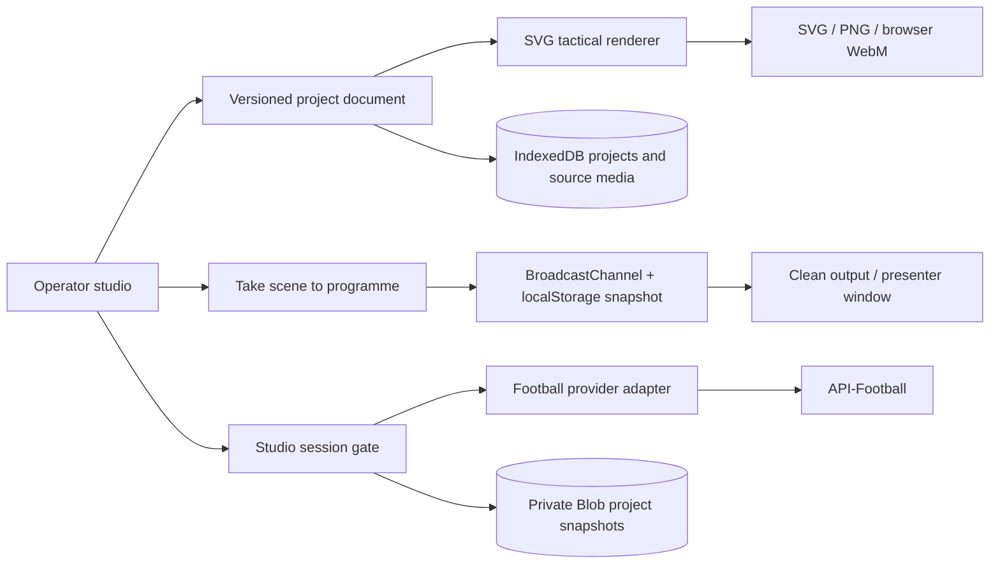

# Architecture

Bang On Tactics is an independent TypeScript application with a React operator studio, an SVG tactical engine and Vercel Node.js server functions. It uses the new `Libanalijama/Football-tactics` repository exclusively. The design prioritizes a large analysis surface, reversible editorial changes and a separate programme picture.

## Boundaries

| Area                               | Responsibility                                                                                                                                                   |
| ---------------------------------- | ---------------------------------------------------------------------------------------------------------------------------------------------------------------- |
| `src/types.ts`                     | Shared, versioned project and programme contracts. Official provider records and editorial players are distinct structures.                                      |
| `src/components/Board.tsx`         | Pitch graphics, player tokens, annotations, pointer-coordinate conversion, dragging and selection. The same renderer is used in operator and clean output views. |
| `src/lib/formations.ts`            | Formation parsing and mirrored home/away positions. It validates ten outfield players rather than accepting arbitrary invalid formations.                        |
| `src/lib/animation.ts`             | Deterministic interpolation of normalized player positions, bounded playhead time and pitch clamping.                                                            |
| `src/lib/storage.ts`               | IndexedDB schema, project/media persistence, quota/error reporting and recent-project recovery.                                                                  |
| `src/lib/validation.ts`            | Strict project/import schema, resource bounds and cross-reference validation. Unknown fields and invalid identifiers are rejected.                               |
| `src/lib/export.ts`                | Safe vector serialization, clean still rendering, project export and cancellable browser recording.                                                              |
| `src/lib/broadcast.ts`             | Programme snapshots and presenter commands across same-origin browser windows.                                                                                   |
| `src/components/Output.tsx`        | Clean programme picture and optional presenter controls. It never enables board editing.                                                                         |
| `server/auth.ts`, `api/session.ts` | Shared workspace authentication, cookie signing/verification, expiry, origin checks and login throttling.                                                        |
| `server/data/*`, `api/football.ts` | Provider-independent data contract, API-Football normalization, cache and authenticated request boundary.                                                        |
| `api/projects.ts`                  | Authenticated private Blob project snapshot operations. Source footage is not uploaded by this endpoint.                                                         |

## Tactical document and rendering

A `Project` owns team settings, ordered scenes, asset metadata and an optional `OfficialMatch` snapshot. Each `Scene` owns its players, annotations, keyframes, duration, media reference/time, presentation settings and notes. Player coordinates use percentages on the pitch, so scene data is independent of the displayed pixel size. The renderer translates them to a 1200×780 SVG canvas with a 1140×720 active field.

Pointer input is transformed through the SVG's screen matrix, making dragging and drawing behave consistently when the board resizes or shows half a pitch. Gestures use a temporary preview and commit when released. Pointer cancellation discards the preview. Noninteractive output uses the same visual implementation without edit callbacks or selection handles. Exports remove elements explicitly marked as editor-only.

Keyframes store positions by stable player ID. Playback sorts frames, bounds time to scene duration and applies smooth interpolation between adjacent frames. It does not infer real player tracking or game events. Formation presets are editorial starting points; they are separate from a provider's reported formation. This engine animates player movement, while annotation paths themselves are static scene objects.

## Official data provenance

The football boundary returns normalized teams, competitions, fixtures and matches with provider namespaced identifiers and retrieval timestamps. Raw API schemas never enter tactical rendering. Server-only credentials are read lazily when a provider request is made, so an offline studio remains usable without an account.

API-Football lacks an explicit lineup confirmation flag in its team-sheet response. This implementation returns `provider-reported` or `unavailable`, never an inferred `confirmed` state. The editor imports a reviewed tactical copy while preserving the provider snapshot. Missing scores/numbers remain null and missing team sheets remain empty; a failed request is not replaced by fictional football data. Historical match requests stay tied to the selected match and season instead of using a current squad.

Badge URLs are stripped unless server configuration explicitly declares the assets licensed. The adapter also accepts only approved HTTPS media hosts. The project retains its own badge-clearance state for editorial use. Rights to provider data, competition coverage and visual assets must be established for the broadcaster's intended territories and distribution.

The bounded warm-instance cache coalesces concurrent lookups and may serve a timestamped, explicitly stale snapshot after a failed refresh. It does not provide distributed coordination or an infinite offline mirror. See [football-data.md](football-data.md) for TTLs, request filters, sources and unimplemented provider capabilities.

## Media and project durability

IndexedDB version 1 has `projects` and `assets` stores. Source media is saved as browser Blobs, with MIME and size checks, and served to media elements using short-lived object URLs. Those URLs are revoked when views change. Supported file containers depend on installed browser codecs. Images and paused video frames sit below the transparent SVG annotation layer; they are not silently uploaded to a cloud service.

Local saves and JSON imports pass the same strict schema. It bounds scene/player/annotation/keyframe counts and rejects duplicate IDs, invalid timeline references, missing asset metadata and more than eleven on-pitch players per team. Imported strings are rendered as React text, not HTML. Source SVG uploads are excluded. JSON imports have a size bound.

Private Blob storage persists the validated project document behind authentication, using deterministic project paths and private reads. It is snapshot storage, not a relational application database. Neither a JSON export nor a cloud snapshot includes source footage. A complete production handoff must also retain and transfer the original media files. Browser storage may be cleared or evicted; exported backups remain necessary for important productions.

## Programme workflow

The operator explicitly publishes a `ProgramState` containing the scene snapshot, team graphics, playback clock, transition, blackout and revision. A localStorage snapshot lets a newly opened output view initialize immediately; BroadcastChannel and storage events carry updates. The clean output `/output` has no operator controls. `/presenter` adds notes, scene stepping, playback, blackout and fullscreen controls. Presenter commands require the operator studio to remain open.

This transport works between windows of the **same origin, browser profile and device**. It is not a remote production bus. Assets are resolved from that origin's IndexedDB. Different Vercel preview URLs, browser profiles or computers do not share programme state or local media. The implementation does not provide NDI, SDI, OBS control, network return feeds, genlock or hardware video output. Browser capture/window capture can be used by an external production system after validating the required resolution, frame rate and latency.

## Authentication and server configuration

Server features are disabled when `STUDIO_PASSWORD` is absent. Login compares the submitted password using constant-time byte comparison, signs a random twelve-hour bearer token with HMAC-SHA256 and returns an HttpOnly, SameSite=Strict cookie, marked Secure for HTTPS/Vercel. Verification checks bounded syntax, signature and absolute expiry. Rotating the configured password invalidates previous cookies.

Authenticated API requests also enforce same-origin checks; writes without an Origin header are rejected. Public status endpoints expose configuration booleans, not secrets. The football route validates allowlisted filters, fixed provider origin/paths, request timeout and per-instance request limits. Provider errors are translated to useful messages without returning upstream bodies or credentials. Cloud mutations validate the project document before writing it.

The shared password is appropriate for a single trusted production workspace. It is not multi-user identity, RBAC, an audit log or centralized session revocation. Login/request counters and provider cache are process-local and reset with server instances. Deployments intended for a larger group need a managed identity provider, distributed rate limiting, revisioned writes and access/audit policies before that broader use.

## Build, deployment and verification

Vite builds the browser bundle; `api/` functions are deployed by Vercel separately. `npm run dev` starts only Vite, so cloud/data endpoints require `vercel dev` or a deployed Vercel project. No runtime secret uses a `VITE_` prefix. The app should be deployed under the requested repository's own Vercel project; no other repository is used for source or delivery.

Tests separate deterministic renderer/animation contracts, strict persistence/import boundaries, provider failure semantics, cookie/origin authorization and browser production workflows. TypeScript checks browser and server code during a production build. Browser-generated PNG/WebM output, deployed private-store permissions, licensed provider coverage and the full broadcaster capture chain require environment-specific validation.

## Current limits

- No football provider account or broadcast/image rights are bundled; live data requires licensed credentials. Only API-Football has an implemented adapter.
- Local-first project/media storage and authenticated private cloud project snapshots are implemented. Cross-device source media sync, multi-user editing, conflict resolution and relational project search are not.
- Programme transport is same-browser, and the operator window remains the command authority. There is no remote presenter session or external switching protocol.
- Telestration is manual. Automatic player tracking, video segmentation, camera calibration and AI analysis are not included.
- Movement interpolation is supported; annotation path animation, complex camera moves, tracking heatmaps and advanced timeline compositing are not.
- SVG/PNG/project export and browser WebM recording are supported where the browser permits. Audio mixing, server render queues, ProRes/H.264 delivery guarantees and archival media packaging are not included.
- The initial build needs real production rehearsal and performance measurements with the intended footage, scene sizes, browser and capture hardware before being treated as a broadcast reliability guarantee.
